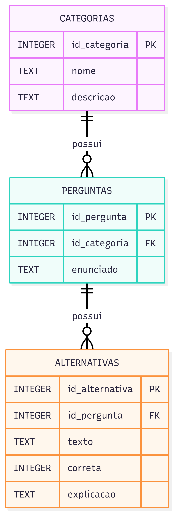

# Guia Interativo de Segurança Digital

## Sobre o projeto

O Guia Interativo de Segurança Digital é uma aplicação web educativa desenvolvida como parte de uma ação de extensão do curso de Tecnologia da Informação da Universidade Federal de Mato Grosso do Sul (UFMS).

O projeto tem como objetivo conscientizar estudantes universitários sobre a importância da segurança e da ética digital, por meio de conteúdos informativos e atividades interativas.

## Funcionalidades

- Apresentação do projeto e de seus objetivos.
- Conteúdos educativos organizados por categorias.
- Informações sobre senhas seguras, autenticação em dois fatores, golpes virtuais, privacidade, segurança acadêmica e ética digital.
- Questionário interativo de múltipla escolha.
- Exibição da pontuação e explicações das respostas.
- Navegação simples e interface responsiva.

## Tecnologias utilizadas

- **Vue.js 3:** framework JavaScript utilizado no desenvolvimento da aplicação.
- **Vite:** ferramenta utilizada para criação e execução do projeto.
- **HTML:** estruturação dos conteúdos.
- **CSS:** estilização e adaptação da interface a diferentes tamanhos de tela.
- **JavaScript:** implementação das funcionalidades e interações.

## Banco de dados e modelagem

Como parte do desenvolvimento do projeto, foi realizada a modelagem e a implementação de um banco de dados relacional utilizando SQLite.

O banco de dados foi estruturado em três tabelas principais:

- **Categorias:** armazena os nomes e as descrições dos temas educativos.
- **Perguntas:** armazena os enunciados das questões e suas respectivas categorias.
- **Alternativas:** armazena as opções de resposta, indicando quais são corretas e apresentando explicações.

As tabelas possuem relacionamentos por meio de chaves primárias e estrangeiras.

**Observação:** o banco de dados SQLite foi desenvolvido como parte das atividades de modelagem e manipulação de dados do projeto, mas não está integrado à aplicação web publicada. Atualmente, os conteúdos educativos e as perguntas do questionário são definidos diretamente no código-fonte da aplicação.
### Diagrama entidade-relacionamento (DER)



### Operações SQL

Foram realizadas operações de manipulação e consulta de dados utilizando comandos SQL:

- **INSERT:** inserção de registros.
- **SELECT:** consulta dos dados armazenados.
- **UPDATE:** atualização de informações.
- **DELETE:** exclusão de registros utilizados em testes.

### Controle de versão

O Git foi utilizado para acompanhar a evolução do projeto, registrar alterações e organizar os arquivos desenvolvidos. O repositório no GitHub foi atualizado com o banco de dados SQLite e o diagrama entidade-relacionamento.

## Como executar o projeto

É necessário ter o Node.js instalado.

1. Clone este repositório:

   ```bash
   git clone https://github.com/erikahih/GuiaInterativoSegurancaDigital.git
   ```

2. Entre na pasta do projeto:

   ```bash
   cd GuiaInterativoSegurancaDigital
   ```

3. Instale as dependências:

   ```bash
   npm install
   ```

4. Inicie o servidor de desenvolvimento:

   ```bash
   npm run dev
   ```

5. Acesse o endereço indicado no terminal, geralmente `http://localhost:5173/`.

## Público-alvo

Estudantes de Arquitetura e Urbanismo da Unigran Capital.

## Instituição

Universidade Federal de Mato Grosso do Sul (UFMS) — Programa de Extensão UFMS Digital.

## Repositório

https://github.com/erikahih/GuiaInterativoSegurancaDigital
